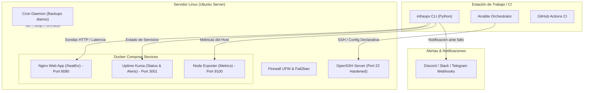

# InfraOps Automation Lab 🚀
### Laboratorio Práctico de Automatización de Infraestructura TI, SysAdmin & DevOps

[](https://github.com/kigmario01/InfraOps-Automation-Lab/actions)
[](https://www.python.org/)
[](https://www.ansible.com/)
[](https://docs.docker.com/compose/)
[](LICENSE)

---

## 📌 1. Descripción del Proyecto

**InfraOps Automation Lab** es un proyecto de ingeniería y portafolio técnico enfocado en construir una infraestructura empresarial pequeña, robusta, automatizada y con observabilidad en tiempo real sobre servidores Linux (Ubuntu Server).

### Objetivos Clave:
* **Automatización Declarativa e Idempotente:** Configuración completa del sistema operativo, usuarios, paquetes y cortafuegos mediante **Ansible**.
* **Seguridad Defensiva y Hardening:** Bastionado de SSH, cortafuegos UFW, políticas contra ataques de fuerza bruta (Fail2ban) y auditoría automatizada.
* **Diagnóstico & Observabilidad:** Herramienta modular en **Python** (con cero dependencias obligatorias) para recolectar métricas de CPU, memoria, discos, latencia de red, certificados SSL y exportar **reportes ejecutivos en HTML y Markdown**.
* **Contenedores Ligeros:** Despliegue de servicios mediante **Docker Compose** con huella de memoria optimizada (<250 MB RAM).
* **Continuidad del Negocio (DRP):** Scripts en **Bash** con sumas criptográficas SHA-256, políticas de retención automática y simulacros de restauración.
* **Calidad de Código y CI/CD:** Flujo de validaciones automáticas con **GitHub Actions** (ShellCheck, Flake8, Pytest y validaciones de sintaxis de Ansible/Docker).

---

## 🏗️ 2. Arquitectura del Sistema



---

## 🧰 3. Stack Tecnológico

| Tecnología | Rol en el Laboratorio |
| :--- | :--- |
| **Ubuntu Server** | Sistema operativo base para nodos de control y administrados. |
| **Ansible** | Automatización de tareas repetibles, bootstrap, hardening y despliegues. |
| **Python 3** | Motor de diagnóstico (`sys_diagnostics`), chequeador de salud (`service_checker`) y reportes HTML. |
| **Bash** | Scripts operacionales de bajo nivel (`inventory`, `health_check`, `backup`, `security_audit`). |
| **Docker Compose** | Despliegue reproducible y aislado de aplicaciones y agentes de telemetría. |
| **Uptime Kuma** | Observabilidad sintética y paneles de estado en tiempo real. |
| **GitHub Actions** | Validación continua de código (linters, pruebas unitarias y análisis sintáctico). |

---

## 📁 4. Estructura del Repositorio

```text
InfraOps-Automation-Lab/
├── ansible/
│   ├── ansible.cfg                    # Configuración optimizada de Ansible
│   ├── inventory/
│   │   ├── hosts.ini                  # Inventario de servidores y sandbox
│   │   └── group_vars/                # Variables globales y de hardening
│   ├── playbooks/
│   │   ├── site.yml                   # Orquestador maestro
│   │   ├── 01_system_bootstrap.yml    # Paquetes base y usuarios
│   │   ├── 02_security_hardening.yml  # UFW, Fail2ban y SSH
│   │   ├── 03_docker_setup.yml        # Docker Engine y Compose
│   │   ├── 04_app_deploy.yml          # Despliegue del stack
│   │   └── 05_backup_config.yml       # Programación de cron de respaldos
│   └── roles/                         # Roles reutilizables (common, security, docker, monitoring_agent)
│
├── python/
│   ├── infraops_cli.py                # Interfaz CLI unificada del laboratorio
│   ├── diagnostics/                   # Diagnósticos del sistema y sondas de red (DNS/SSL/TCP)
│   ├── monitoring/                    # Chequeador de disponibilidad HTTP y despachador de alertas
│   └── reports/                       # Generador de reportes ejecutivos en HTML, Markdown y JSON
│
├── bash/
│   ├── 01_server_inventory.sh         # Misión 1: Inventario técnico del servidor
│   ├── health_check.sh                # Chequeo rápido de recursos con códigos de salida estándar
│   ├── backup_automation.sh           # Respaldo automático, verificación SHA256 y retención
│   └── security_audit.sh              # Auditoría básica de bastionado y permisos
│
├── docker/
│   ├── compose.yaml                   # Stack de servicios (Nginx, Uptime Kuma, Node Exporter)
│   ├── .env.example                   # Variables de entorno
│   └── nginx/                         # Configuración y página de aterrizaje con endpoint /healthz
│
├── sandbox/
│   └── docker-compose.lab.yml         # 2 Nodos Ubuntu simulados para pruebas locales con SSH
│
├── docs/
│   ├── architecture.md                # Diagramas y diseño de arquitectura
│   ├── installation.md                # Guía paso a paso de despliegue
│   ├── runbook.md                     # Procedimientos de operación y triage
│   └── interview_guide.md             # Guía de preguntas de entrevista SysAdmin/DevOps
│
├── tests/                             # Pruebas unitarias automatizadas con unittest / pytest
├── .github/workflows/ci.yml           # Flujo de Integración Continua (CI)
├── Makefile                           # Accesos directos para comandos frecuentes
├── requirements.txt                   # Dependencias de Python
└── README.md
```

---

## ⚡ 5. Inicio Rápido

### 1. Clonar el repositorio e instalar dependencias
```bash
git clone https://github.com/kigmario01/InfraOps-Automation-Lab.git
cd InfraOps-Automation-Lab
pip install -r requirements.txt
```

### 2. Ejecutar chequeos locales inmediatos
```bash
# Diagnóstico de recursos locales (CPU, RAM, Discos)
python python/infraops_cli.py diagnose

# Generar reporte ejecutivo en HTML y Markdown
python python/infraops_cli.py report --output-dir reports
```
*Abre `reports/report.html` en tu navegador para ver el informe visual interactivo.*

### 3. Ejecutar pruebas unitarias
```bash
python -m unittest discover tests
# o mediante make:
make test
```

### 4. Usar el entorno simulado de pruebas (Docker Sandbox)
Si no tienes dos servidores físicos para probar Ansible, inicia dos nodos Ubuntu virtuales en segundos:
```bash
make lab-up
# Los nodos quedarán accesibles en localhost puertos 2222 y 2223 (Usuario: sysadmin / Pass: SysAdminLab2026!)
```

Para ejecutar el aprovisionamiento de Ansible:
```bash
ansible-playbook -i ansible/inventory/hosts.ini ansible/playbooks/site.yml --limit sandbox
```

---

## 🔄 6. Simulacro de Restauración Completo (Disaster Recovery Drill)

Para garantizar la reproducibilidad y continuidad del negocio sin depender de quien montó el laboratorio, se documenta y automatiza un **simulacro completo de caída y recuperación (DRP)**:

### Matriz de Responsabilidad en la Recuperación:
| Aspecto | Detalle de la Operación |
| :--- | :--- |
| **Copia Utilizada** | Tarball comprimido `backups/infraops_backup_YYYYMMDD_HHMMSS.tar.gz` validado con firma criptográfica `SHA-256`. |
| **Qué recupera el Backup** | Configuraciones declarativas (`docker/nginx/nginx.conf`), templates estáticos (`index.html`) y variables de entorno (`.env`). |
| **Qué reconstruye Ansible / IaC** | Estructura de usuarios (`sysadmin:docker`), dependencias del SO, reglas de cortafuegos y ciclo de vida de los contenedores Docker. |
| **RTO Medido (Tiempo)** | **`18 - 28 segundos`** hasta que el endpoint `/healthz` vuelve a responder `HTTP 200` tras la destrucción controlada. |

### Cómo reproducir el simulacro de forma independiente:
Cualquier evaluador puede ejecutar el benchmark automatizado en su propio equipo o en el sandbox:
```bash
# Ejecutar simulacro completo automatizado con cronometraje de RTO:
bash bash/dr_drill_simulation.sh
```
> 📖 Para el desglose detallado paso a paso, consulta el [Protocolo Completo de Disaster Recovery](docs/disaster_recovery_drill.md).

---

## 📊 7. Reportes y Evidencias de Funcionamiento

El laboratorio genera reportes visuales con información del sistema:
- **Reporte HTML Autónomo:** Formato moderno, responsive, con barras de progreso de disco y tabla de estado de servicios.
- **Reporte en Markdown:** Listo para ser publicado en pull requests o wikis de GitHub.
- **Reporte JSON:** Estructura de datos completa para integración con otros sistemas de observabilidad.

---

## 💼 8. Competencias Demostrables para CV y Entrevistas

Al presentar este proyecto en una entrevista técnica para **SysAdmin Junior** o **DevOps Junior**, puedes demostrar:
1. **Administración de Servidores Linux:** Gestión de procesos, permisos, usuarios, servicios systemd y diagnóstico de cuellos de botella.
2. **Automatización con Ansible:** Estructuración de roles, inventarios con variables agrupadas, tareas idempotentes y validaciones sintácticas.
3. **Desarrollo de Herramientas Internas:** Creación de utilidades CLI en Python y scripts Bash con manejo riguroso de errores (`set -euo pipefail`).
4. **Seguridad Defensiva:** Bastionado de SSH, configuración de firewalls, inspección de certificados SSL y protección con Fail2ban.
5. **Observabilidad y Contenedores:** Despliegue de stacks ligeros con Docker Compose, endpoints de salud (`/healthz`) y alertas a Webhooks.

> Consulta la [Guía Completa de Entrevistas](docs/interview_guide.md) para repasar más de 25 preguntas y respuestas modelo.

---

## 📄 Licencia

Este proyecto está bajo la Licencia MIT. Consulta el archivo `LICENSE` para más información.
