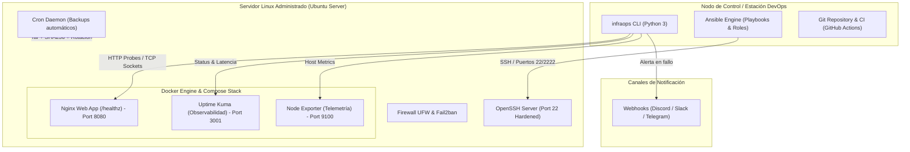
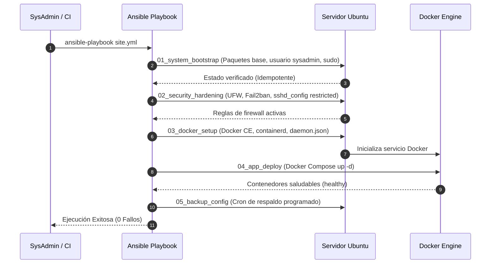

# Arquitectura del Laboratorio: InfraOps Automation Lab

Este documento detalla el diseño de arquitectura, los flujos de comunicación y los componentes de automatización implementados en **InfraOps Automation Lab**.

---

## 1. Visión General de la Arquitectura

El laboratorio está diseñado siguiendo el principio de **separación de responsabilidades** y **consumo eficiente de recursos**, permitiendo administrar tanto servidores físicos como instancias virtualizadas o contenedores de prueba.

---

## 2. Componentes del Stack

| Componente | Rol en la Infraestructura | Tecnologías |
| :--- | :--- | :--- |
| **Control & Orquestación** | Ejecutar configuraciones declarativas e idempotentes. | Ansible 2.15+, Python 3.10+ |
| **Seguridad Perimetral** | Restringir accesos, prevenir ataques de fuerza bruta y bloquear puertos no autorizados. | UFW, Fail2ban, SSH Hardening |
| **Servicios Desplegados** | Aplicación web proxy y panel de observabilidad de bajo consumo (<250MB RAM). | Docker Compose, Nginx Alpine, Uptime Kuma |
| **Motor de Diagnóstico** | Inspección en tiempo real de CPU, RAM, discos, sockets y certificados SSL. | Python Standard Library (`sys_diagnostics`, `network_probe`) |
| **Observabilidad & Alertas** | Monitoreo sintético de endpoints y alertas automáticas vía Webhooks. | `service_checker.py`, `alert_manager.py` |
| **Continuidad del Negocio** | Respaldo comprimido con suma criptográfica SHA256 y retención de 7 días. | `backup_automation.sh` |

---

## 3. Flujo de Trabajo de Automatización (Ansible)

El despliegue sigue un ciclo escalonado que garantiza la estabilidad del sistema antes de aplicar configuraciones avanzadas:

---

## 4. Estrategia de Respaldo y Recuperación (DRP)

1. **Captura:** Cada ejecución respalda la configuración de Docker Compose, variables de entorno y datos persistentes.
2. **Compresión:** Genera un archivo tarball comprimido con `gzip` (`infraops_backup_YYYYMMDD_HHMMSS.tar.gz`).
3. **Verificación:** Inmediatamente valida la integridad del archivo mediante `tar -tzf` y calcula el hash `SHA-256`.
4. **Rotación:** Aplica política de retención automática purgando respaldos con más de 7 días de antigüedad.
5. **Recuperación:** Soporta comando de restauración automatizado (`backup_automation.sh --restore <archivo> <destino>`).
