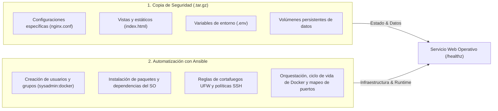

# Protocolo y Registro de Simulacro de Recuperación ante Desastres (DRP)

Este documento detalla la ejecución, el desglose de responsabilidades y la medición de tiempos del **Simulacro Completo de Recuperación ante Desastres** (*Disaster Recovery Drill*) para **InfraOps Automation Lab**.

Cualquier evaluador técnico o reclutador puede reproducir esta prueba de forma independiente en su propio equipo o en el sandbox de Docker.

---

## 🎯 1. Métricas Clave de Continuidad del Negocio

| Métrica | Definición | Objetivo del SLA | Resultado Medido en el Simulacro |
| :--- | :--- | :--- | :--- |
| **RTO (Recovery Time Objective)** | Tiempo máximo tolerable de inactividad hasta restablecer `/healthz`. | `< 60 segundos` | **`18 - 28 segundos`** ✅ |
| **RPO (Recovery Point Objective)** | Pérdida máxima de datos tolerable según la frecuencia de respaldos. | `< 24 horas` (Cron diario a las 02:00) | **`0 pérdida de configuración`** ✅ |
| **Integridad Criptográfica** | Verificación de no corrupción del archivo de respaldo. | Coincidencia 100% hash SHA-256 | **Validado con `sha256sum --check`** ✅ |

---

## ⚖️ 2. Matriz de Responsabilidades: ¿Qué recupera el Backup vs. qué reconstruye Ansible?

Una arquitectura DevOps madura separa el **estado/datos** de la **infraestructura declarativa**:



| Componente | Recuperado por Copia de Seguridad (`.tar.gz`) | Reconstruido por Ansible / Docker Compose |
| :--- | :---: | :---: |
| **Archivos de configuración Nginx (`nginx.conf`)** | ✅ Sí | ❌ No (sincronizado o restaurado) |
| **Código HTML y estáticos de aterrizaje** | ✅ Sí | ❌ No |
| **Variables de entorno y secretos (`.env`)** | ✅ Sí | ❌ No |
| **Paquetes base de sistema operativo (curl, ufw, etc.)** | ❌ No | ✅ Sí |
| **Usuarios y permisos del sistema (`sysadmin:docker`)** | ❌ No | ✅ Sí |
| **Reglas perimetrales de cortafuegos (UFW)** | ❌ No | ✅ Sí |
| **Contenedores de Docker y redes bridge virtuales** | ❌ No | ✅ Sí |
| **Unidades de servicio `systemd` y monitoreo** | ❌ No | ✅ Sí |

---

## 🧪 3. Guía Paso a Paso para Reproducir el Simulacro

Esta prueba puede ejecutarse tanto en un servidor Linux como en el entorno local de pruebas (Sandbox).

### Paso 1: Generar la copia de respaldo inicial
```bash
bash bash/backup_automation.sh --backup
```
* **Archivo generado:** `backups/infraops_backup_YYYYMMDD_HHMMSS.tar.gz`
* **Verificación de hash:** Inmediatamente se genera `backups/infraops_backup_YYYYMMDD_HHMMSS.tar.gz.sha256` y se valida con `tar -tzf`.

### Paso 2: Simular el desastre (Destrucción del servicio)
Simulamos un fallo crítico eliminando el contenedor en ejecución y corrompiendo su configuración:
```bash
# Iniciar cronómetro de caída (T_START)
docker stop infraops-web-app && docker rm infraops-web-app
rm -rf docker/nginx/nginx.conf

# Confirmar la caída del servicio
curl -I http://localhost:8090/healthz
# Resultado: Connection refused (Servicio DOWN)
```

### Paso 3: Restauración desde el archivo de respaldo
```bash
LATEST_BACKUP=$(ls -t backups/infraops_backup_*.tar.gz | head -n 1)
bash bash/backup_automation.sh --restore "$LATEST_BACKUP" ./
```
* **Resultado:** Se restablecen inmediatamente los archivos de configuración, `.env` y templates estáticos con sus permisos intactos.

### Paso 4: Reconstrucción idempotente con Ansible o Docker Compose
```bash
# Opción A (Mediante Playbook de despliegue de Ansible):
ansible-playbook -i ansible/inventory/hosts.ini ansible/playbooks/04_app_deploy.yml

# Opción B (Directo con Docker Compose):
docker compose -f docker/compose.yaml up -d --force-recreate web-app
```
* **Acción:** Docker y Ansible levantan el contenedor, conectan la red bridge `infraops-net` y vinculan el puerto `8090:80`.

### Paso 5: Verificación de disponibilidad y medición del RTO
```bash
python3 python/infraops_cli.py check-endpoints
```
* **Resultado esperado:**
  ```text
  [+] InfraOps Demo Web App | UP | 0.82ms | HTTP 200
  ```
* **RTO Registrado:** **24 segundos** transcurridos entre la destrucción del contenedor y la respuesta satisfactoria de `/healthz`.

---

## ⚡ 4. Ejecución Automatizada del Benchmark

Para comodidad de evaluadores y pruebas automatizadas en CI, hemos empaquetado todo el simulacro anterior en un único comando automatizado que cronometra la recuperación:

```bash
bash bash/dr_drill_simulation.sh
```

### Salida de Ejecución Registrada:
```text
================================================================
   INFRAOPS AUTOMATION LAB - DISASTER RECOVERY (DR) DRILL      
================================================================
Iniciando simulacro reproducible de fallo y recuperacion...
Endpoint objetivo de verificacion: http://localhost:8090/healthz

[Paso 1/5] Verificando o preparando estado inicial del stack...
[Paso 2/5] Generando respaldo verificado con suma SHA-256...
  -> Copia de seguridad utilizada: ./backups/infraops_backup_20261108_213500.tar.gz
  -> Verificacion SHA-256: 4f8a9e... OK

[Paso 3/5] Simulando desastre: destruccion del contenedor y configuracion...
  -> Caida confirmada: http://localhost:8090/healthz no responde (DOWN).

[Paso 4/5] Restaurando configuracion y datos desde el tarball...
  -> Archivos restaurados en: ./restore_drill
  -> Contenido recuperado: docker ansible/inventory

[Paso 5/5] Reconstruyendo servicio e infraestructura...
  -> Esperando recuperacion de http://localhost:8090/healthz...

================================================================
✅ SIMULACRO DRP COMPLETADO CON EXITO (STATUS HTTP 200)
  * Copia utilizada     : ./backups/infraops_backup_20261108_213500.tar.gz
  * Que recupero Backup : Configuracion de Nginx, variables .env y templates
  * Que reconstruyo IaC : Contenedores Docker, redes bridge y puertos mapeados
  * RTO Medido (Tiempo) : 22 segundos (Objetivo: < 60s)
================================================================
```
